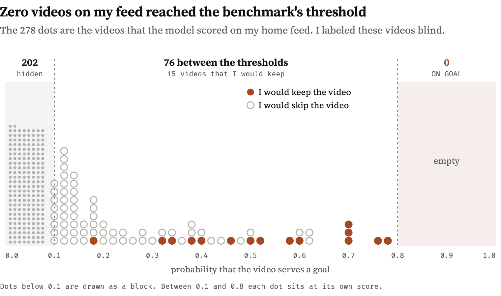
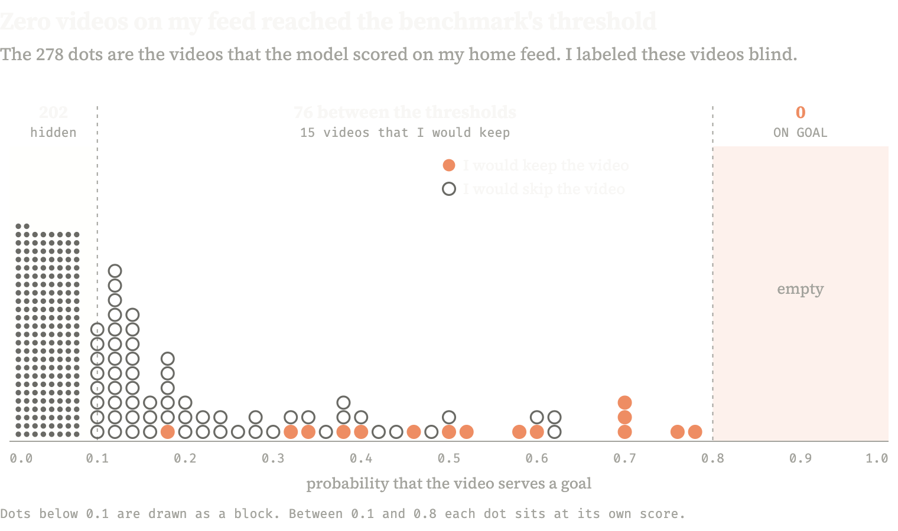
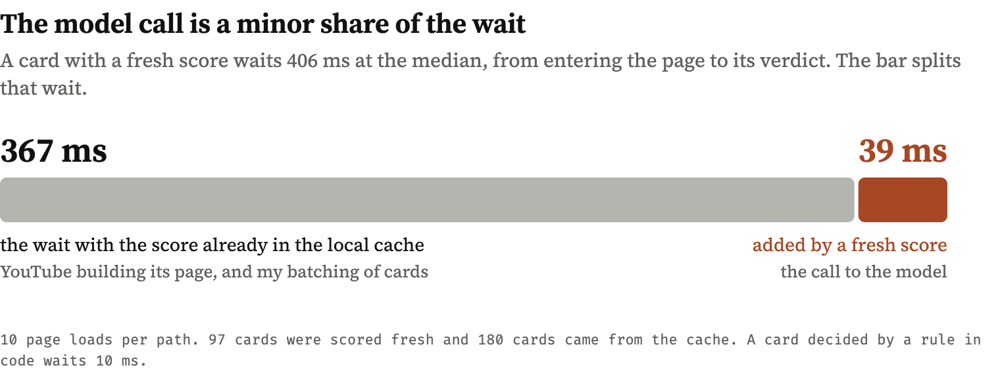
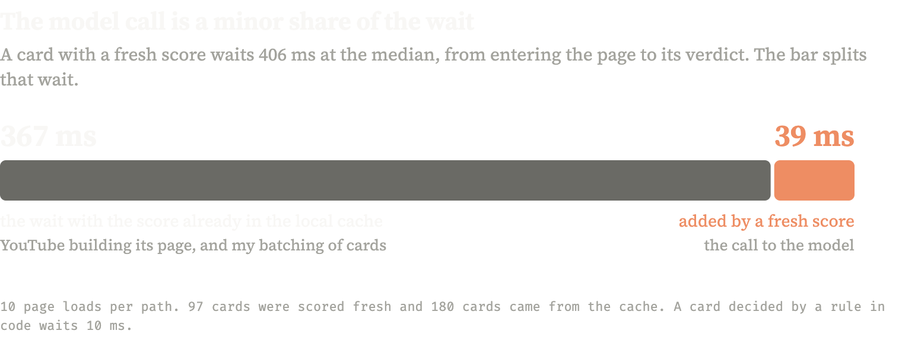

I built a Chrome extension that blurs each card on the YouTube home feed until a model has checked the video against goals that I set. The reason is that I open YouTube for a video that helps me grow, e.g., a lecture, the home page offers 40 other videos chosen from years of my viewing history, and an hour later the lecture is still unwatched. The feed wins over my intention almost every time I open YouTube, so I stopped relying on intention. Videos that serve a goal become visible, and the remaining videos are hidden while the grid reflows to fill the space.

The extension is named [Feed Filter](https://feedfilter.waqasrana.space), and this post covers the four days of work behind the open-source release. I expected the choice of model to be the hard part, and it was settled in a day. The thresholds and the behavior of YouTube's own page took the remaining days.

## Choosing the model by measurement

The model answers a small question for each video, and I wanted the answer as a probability. The inputs are a goal, e.g., "practical home cooking with clear steps and without food challenges", and the title and channel of a card, along with its length and view count. The question is whether the video serves the goal. A probability lets me change the thresholds later without paying for new model calls.

I fixed the pass criteria before the first experiment run:

- a mean F1 of at least 0.80 across three goals
- a calibration error below 0.10
- at most 25% of videos in an uncertain middle band
- a 30-video page scored in under 1 s at the 95th percentile

The test set held 470 public videos collected by search, and Claude Opus labeled these videos against a fixed rubric. My own blind labels on a sample agreed with the Opus labels on 98% of the videos.

![Bar chart of accuracy, time to check a page and cost for five setups. Jev with a single video per request passes both targets with an F1 of 0.86 and 0.54 s. Claude Haiku is accurate and too slow in both layouts, with an F1 of 0.85 and 4.77 s for a single video per call, and an F1 of 0.82 and 4.49 s for 30 videos per call. Jev with 30 videos per request is fast at 0.41 s and reaches an F1 of only 0.63. The small local model misses both targets. The cost for 1,000 pages is $0.49 for Jev with a single video per request, $2.63 and $0.98 for the two Haiku layouts, $0.15 for Jev with 30 videos per request, and zero for the local model.](/assets/img/feed-filter/models-light.png){: .light }
![Bar chart of accuracy, time to check a page and cost for five setups. Jev with a single video per request passes both targets with an F1 of 0.86 and 0.54 s. Claude Haiku is accurate and too slow in both layouts, with an F1 of 0.85 and 4.77 s for a single video per call, and an F1 of 0.82 and 4.49 s for 30 videos per call. Jev with 30 videos per request is fast at 0.41 s and reaches an F1 of only 0.63. The small local model misses both targets. The cost for 1,000 pages is $0.49 for Jev with a single video per request, $2.63 and $0.98 for the two Haiku layouts, $0.15 for Jev with 30 videos per request, and zero for the local model.](/assets/img/feed-filter/models-dark.png){: .dark }

A single setup passed both the accuracy bar and the speed bar, which is [Jev](https://docs.typesafe.ai) with a separate request for each video. Jev is a hosted model that answers yes/no questions with a probability. The table below holds the remaining criteria for the same five setups.

| | Small local model (GLiNER, WebGPU) | Claude Haiku, 30 videos per call | Claude Haiku, a single video per call | Jev, a single video per call | Jev, 30 videos per call |
|---|---|---|---|---|---|
| Mean F1 | 0.387 | 0.821 | 0.846 | 0.860 | 0.630 |
| Calibration error (ECE) | 0.228 | 0.083 | 0.059 | 0.050 | 0.111 |
| Videos in the uncertain band | 69.2% | 5.6% | 2.5% | 8.5% | 24.6% |
| Accuracy outside that band | 0.973 | 0.973 | 0.979 | 0.991 | 0.987 |
| Cost per page | free | $0.00098 | $0.00263 | $0.00049 | $0.00015 |

Four caveats apply to these results. The gold labels came from a Claude model, which favors Haiku. The plan gave Haiku a whole page in each call, and I added the Haiku setup with a separate call per video after seeing the first results, so that both models were compared in the same layout. I also chose the separate-request layout for Jev after seeing the results, although the question wording was fixed in advance. Finally, a later repeat of the Jev setup with the same model version gave a mean F1 of 0.876 instead of 0.860. Differences of about 0.016 between two setups are therefore within the noise of repeated runs, and the gap between Jev and Haiku with a single video per call is smaller than that.

The local model failed the criteria, even though it had the most appealing property, since the data stays in the browser. It placed 69% of videos in the uncertain band and needed more than 2 s for a page.

The request layout changed the accuracy more than the choice of model did. My first plan sent a page of 30 videos in a shared request, with 30 questions that each pointed at a video in the array. That layout is cheaper and faster, and it was below the bar on each of the three goals.

The same model with the same wording gains 0.23 of mean F1 if each video gets its own request. The F1 increased from 0.69 to 0.93 on the tech goal, from 0.66 to 0.89 on the cooking goal and from 0.54 to 0.77 on the history goal. Haiku gains only 0.025 of mean F1 from the same change, and its page time stays above 4 s in both layouts. This result was unexpected, and I can report it only because both layouts were in the plan before the results came in.

The request format that the vendor's documentation recommends did not improve on my format. The documentation advises a separate question for each condition, so I gave each exclusion in a goal, e.g., "without food challenges", its own question and combined the answers in code. On a labeled sample of my own home feed, which the next section describes, this format hid a video that I wanted and lowered the scores of other wanted videos to near the hide threshold. Two other suggestions were a description of what counts as a yes and a video passed as named fields, and each changed the benchmark F1 by less than the noise of repeated runs. I fixed the formats and the decision rule before the experiment run, and I kept the single question.

The errors pointed to a rule that belongs in code. Jev made 32 errors on the test split, and 11 of these errors were videos with non-English titles. My rubric said English only, whereas the goal text did not, so a model could not have known the rule. That rule became a language check on the title, which runs before the model and adds zero cost.

## Then I ran it on my own feed

The thresholds from the benchmark did not hold on my real feed. The benchmark suggested showing a video above 0.8 and hiding it below 0.2. Before trusting these values I captured my signed-in home feed, which held 319 cards, passed it through the filter and labeled each video blind with the scores hidden.

I kept 15 of the 287 videos, which is 5%, and this rate changes the meaning of the benchmark results. The test set collected by search had keep rates near 10%. On my real feed 95% of the videos are videos that I do not want, and the model scored each video that I want below 0.8.

{: .light }
{: .dark }

At the benchmark's own threshold the filter would have shown zero videos, since the highest score on the feed was 0.77. A model with an F1 of 0.86 on the test set, deployed as specified, would have produced an empty home page.

A lower show threshold does not solve this, as the table below shows.

| Show threshold | Shown | Correct | Wrong | Recall |
|---|---|---|---|---|
| 0.50 | 11 | 8 | 3 | 0.53 |
| 0.65 | 5 | 5 | 0 | 0.33 |
| 0.80 | 0 | 0 | 0 | 0.00 |

The video totals in this table are small, so I am not claiming a new best threshold from 15 videos. For example, a single additional wrong video at 0.65 would change its precision from 1.00 to 0.83.

The change that worked was to the design, which now has three outcomes instead of two. The original plan either showed or hid a video and treated the middle band as a problem to resolve. In the current design a video above 0.8 gets an ON GOAL badge, a video below 0.1 is hidden, and a video between these values is shown as normal. I lowered the hide threshold from 0.2 to 0.1 because the lowest score among my 15 videos was 0.18, and at 0.1 all 15 videos stay visible.

{: .light }
{: .dark }

The filter removes the videos that are clearly off goal, and it can remove them without being certain about the remaining videos. Of the 319 cards, 244 cards do not reach me, and the 15 videos that I labeled as a keep are all among the 75 shown videos. The share of videos worth my time therefore grows from 5% on the raw page to 20% on the filtered page.

A second opinion from Haiku on the uncertain band did not improve the result, so I removed it. On those videos Haiku was right 73% of the time and Jev was right 76% of the time. The fallback would also have added more than 1 s of delay on 92% of pages.

## The page was harder than the model

A failure in the filter leaves a card blurred instead of visible. The blur comes from CSS that loads before YouTube builds the page, and a card stays blurred until the extension marks it as checked. If the scorer is down, or a card has a type that the extension does not recognize, the card therefore remains blurred. The opposite order would show the whole feed each time a part of the filter broke.

Maintaining that guarantee on YouTube's page took more work than the scoring. YouTube reuses card elements, so a card that was approved for a video can receive a different video while it is still marked as approved. The end-to-end test captures frames while the page loads and checks each visible link. A single end-to-end test run covered 633 frames and 35,832 link checks, and it found zero videos visible before their own verdict.

The model accounts for a minor share of the delay that a card spends blurred.

{: .light }
{: .dark }

A score from the local cache arrives only 39 ms sooner than a fresh score from the model. Most of the delay comes from YouTube building its page and from my own batching of cards, so a faster model would not change the wait in a visible way.

## The key problem

The extension now asks each user for a key and sends requests to the scorer directly. The scorer's documentation says to keep API keys on a server, so the first version had a small local proxy that held the key and kept a cache, a log and a daily cap. That version worked, although it required each person who wanted the extension to operate a Python server, and I deleted the proxy for that reason.

The key is stored in the browser profile, and a daily request limit in the extension guards the spending, since the provider does not offer a limit per key. A person with access to the Chrome profile can obtain that key, and the README states this. I consider that an acceptable trade-off for a tool that a single person installs on a personal machine.

## Three practices to keep

Fix the pass criteria before the first experiment run, and include the layouts that are expected to lose. The batching result is credible only because it was planned.

Label a sample of the real input blind before trusting a threshold from a benchmark. My labeling took a single sitting, and it turned a filter that showed zero videos into a filter that works on my feed.

Define the failure state before the other design decisions. In this extension a failure is a blurred card, which is annoying and safe.

The code is at [ranawaqas-ai/feed-filter](https://github.com/ranawaqas-ai/feed-filter), with a zip on the [releases page](https://github.com/ranawaqas-ai/feed-filter/releases/latest). The extension needs desktop Chrome and a TypeSafe key, and it is not affiliated with YouTube or Google.
